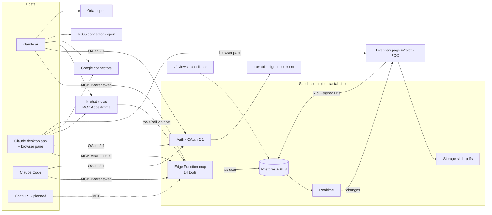
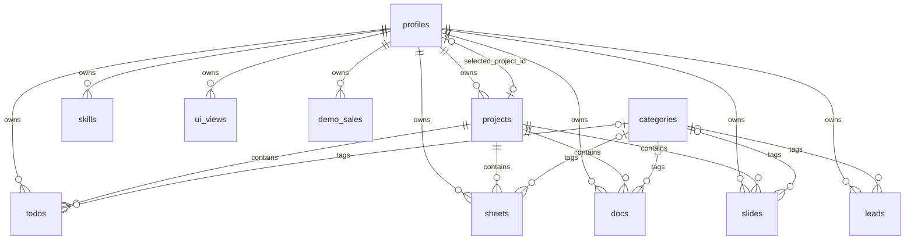

# Cantab OS — Diagram input

| Status | Version | Owner | Last updated |
| --- | --- | --- | --- |
| Current | v0.1 | Nela | 2026-10-22 |

Source for two target-architecture diagrams: (1) the agent architecture, (2) the database. Taken from the
migrations in `supabase/migrations/`, the function code in `supabase/functions/mcp/` and the plan docs, as of
function **v0.7.0** (projects). Update it in the same change as any schema, tool or component change.

Markers: **[built]** exists and is deployed · **[POC]** built as a proof of concept, to be reworked ·
**[planned]** agreed, not built · **[candidate]** from the v2 draft (`cantapi_os_2_0.md`, work in progress), not
agreed · **[open]** not decided.

---

## 1. Agent architecture (target state)

### 1.1 Components

| # | Component | What it does | State |
|---|---|---|---|
| H1 | **claude.ai** (web) | Chat host. Runs the model, calls Cantab OS tools over MCP, renders the in-chat views (MCP Apps), runs its own connectors (Google, M365) | **[built]** connected as Nela; Siniša's connection not logged |
| H2 | **Claude desktop app** | Same host as H1, plus a **browser pane** (side panel) that opens Google file urls and the live view page | **[POC]** used for the live views demo |
| H3 | **Claude Code** | Host for development and testing; calls the same MCP server; ignores the in-chat views | **[built]** connected as Nela |
| H4 | **ChatGPT** | Second chat host over MCP (Apps SDK) | **[planned]** later; nothing built |
| M1 | **Cantab OS MCP server**: Supabase Edge Function `mcp` (Deno, `@modelcontextprotocol/server`, `@supabase/server`) | 14 tools (§2.6). Checks the user's access token and acts **as that user**, so RLS decides every row. No service role. Serves the in-chat view HTML as an MCP resource (`ui://cantab-os/list/<hash>`) | **[built]** v0.7.0 |
| M2 | **In-chat views** (MCP Apps iframe, HTML bundled in M1) | Draws `list` results in the chat: todos by due date with tick-and-save, leads and files by category, projects as a plain list | **[built]**; projects picker and scope badge **[planned]** (phase 3) |
| A1 | **Sign-in and consent app** (Lovable, `cantabpios.lovable.app`) | Sign-in page and `/oauth/consent` for Supabase Auth's OAuth 2.1 server | **[built]** |
| A2 | **Live view page** (Lovable, `/v/:slot`, slots 1–10) | A browser page the agent steers: shows a slide PDF or the sales dashboard; follows changes over Realtime | **[POC]** published 2026-10-21; "Follow Claude" requested |
| A3 | **v2 views** (`os.cantabpi.com/1…10`): Engagement starter, Analyst, Value calculator, Presentation builder, Project Manager, Team manager, Story builder, Agent builder, Proposal builder | Polished views of (partly dummy) data for one mockup project; header with icons to switch views; agent sets template and parameters per slot | **[candidate]** phase 2; Siniša is preparing them as a package. Host (Lovable or own) **[open]** |
| D1 | **Supabase project** `cantabpi-os` (Postgres 17, eu-west-1) | Database (§2), Auth (OAuth 2.1 server, dynamic client registration on, sign-ups off, ES256), Storage, Realtime, PostgREST | **[built]** |
| S1 | **Skills** (table `skills`) | Stored workflows (description + guideline) the host fetches with `get` and follows. Shared by all projects | **[built]** |
| S2 | **Host-native skills** (claude.ai Skills) | Not used by Cantab OS | **[open]** |
| C1 | **Google connectors** (Drive, Docs, Sheets, Slides) | Run by the host with the user's own Google sign-in. Cantab OS stores only pointers (name, url, context) | **[built]** host side; Cantab OS never calls Google |
| C2 | **Microsoft 365 connector** (Outlook, Teams, SharePoint) | Host connector, available in claude.ai | **[open]** no Cantab OS use defined |
| C3 | **Oria connector** | Not described in the repo | **[open]** Nela to describe: what it is, who calls it |
| G1 | **Agents / subagents** | None in Cantab OS. The host's model is the only agent; it reads skills and calls tools | **[open]** v2 "Agent builder" view suggests agent definitions later |

### 1.2 Calls (who calls whom)

| From | To | Protocol | What | State |
|---|---|---|---|---|
| H1, H2, H3 | M1 | MCP over HTTPS (Streamable HTTP, JSON-RPC 2.0), `Authorization: Bearer <user access token>` | `tools/list`, `tools/call`, `resources/read` | **[built]** |
| H1, H2, H3 | D1 Auth | OAuth 2.1 with dynamic client registration; discovery via M1's `/.well-known/oauth-protected-resource` and the 401 `WWW-Authenticate` challenge | Sign-in, token, refresh | **[built]** |
| D1 Auth | A1 | Browser redirect | Sign-in and consent screens | **[built]** |
| M1 | D1 | PostgREST and RPC through supabase-js, as the signed-in user | Reads and writes per §2.6 | **[built]** |
| H1, H2 | M2 | MCP Apps: sandboxed iframe, `postMessage` JSON-RPC (`ui/initialize`, `ui/notifications/tool-result`, `size-changed`) | Renders `structuredContent` of `list` | **[built]** |
| M2 | H1, H2 → M1 | `postMessage` `tools/call`, which the host sends to M1 | Save ticked todos (`edit`) | **[built]**; select a project from the picker **[planned]** |
| M2 | H1, H2 | `ui/open-link` | Open a Google file url | **[built]** |
| M2 | H1, H2 | `ui/update-model-context` | Tell the model what the user did in the view | **[planned]** (phase 3) |
| H1, H2 | C1, C2 | Host connectors, the user's own OAuth with Google or Microsoft | Read and edit Google files, mail, calendar | **[built]** host side |
| H2 browser pane | Google | HTTPS | Open a Google file by its url | **[built]** |
| H2 browser pane, or any browser | A2 | HTTPS | Show the live view page, signed in through Supabase Auth | **[POC]** |
| A2 | D1 | supabase-js as the signed-in user: RPC `view_open`, `view_update`, `view_close`, `views_list`, `dashboard_sales_overview`; Storage signed urls; Realtime websocket on `ui_views`, `demo_sales`, `slides` | Load, change and follow a view | **[POC]** |
| M1 (`view` tool) | D1 → A2 | Writes `ui_views` through `view_agent_apply`; the page follows over Realtime | Agent steers the page | **[POC]** |
| A3 | D1 | As A2 (assumed) | v2 views | **[candidate]** |
| H4 | M1 | MCP | As H1 | **[planned]** |
| M1 | C1, C2, C3 | — | M1 calls no external service | **[built]** by design |

### 1.3 Rules that shape the diagram

- One MCP server, one function. Every tool acts as the signed-in user; RLS in Postgres is the only access check.
- The user works in **one selected project** (stored on `profiles`). Todos, sheets, docs and slides belong to one
  project each; leads and skills are shared. Without a selected project, tools fail except project calls.
- Content from Google and Microsoft never passes through Cantab OS: the host fetches it.
- The live page and the in-chat views carry no secrets; the page uses the publishable key and the user's session.

---

## 2. Database (target state)

Schema `public` unless named. Every table has RLS on; `anon` has no table rights; `authenticated` has no
TRUNCATE. Conventions: primary key `id`, foreign key `<table>_id`, owner column `profile_id`.

### 2.1 Tables

**`profiles`** [built] — one row per Auth user, made by trigger `on_auth_user_created`.

| Column | Type | Rules |
|---|---|---|
| id | uuid | PK; FK → `auth.users.id` on delete cascade |
| email | text | |
| display_name | text | |
| selected_project_id | uuid | FK → `projects.id` on delete set null. The one selected project [built v0.7.0] |
| created_at, updated_at | timestamptz | not null, default now(); `updated_at` by trigger |

**`projects`** [built v0.7.0]

| Column | Type | Rules |
|---|---|---|
| id | uuid | PK, default gen_random_uuid() |
| label | text | not null, unique, default `next_label('project')` → `project:N` |
| label_no | integer | generated from label, indexed |
| name | text | not null |
| icon | text | emoji |
| context | text | dated notes, via `append_context` |
| profile_id | uuid | not null, default auth.uid(), FK → `profiles.id` on delete cascade, indexed |
| created_at, updated_at | timestamptz | as above |

**`todos`** [built]

| Column | Type | Rules |
|---|---|---|
| id | uuid | PK |
| label | text | not null, unique, default `next_label('todo')` |
| label_no | integer | generated, indexed |
| name | text | not null |
| due | date | |
| importance | smallint | check 1–3 |
| status | boolean | not null, default false (true = done) |
| action | text | current next action; old value kept in context by trigger |
| context | text | |
| category_id | integer | FK → `categories.id`, indexed |
| project_id | uuid | **not null**, default `current_project_id()`, FK → `projects.id` on delete restrict, indexed [built v0.7.0] |
| profile_id | uuid | not null, default auth.uid(), FK → `profiles.id` on delete cascade, indexed |
| created_at, updated_at | timestamptz | |

**`sheets`**, **`docs`** [built] — `id`, `label` (`sheet:N` / `doc:N`), `label_no`, `name` (not null), `url`,
`importance` (1–3), `action`, `context`, `category_id`, `project_id` (as todos), `profile_id`, `created_at`,
`updated_at`.

**`slides`** [built] — as sheets, plus `storage_url` (text: the PDF copy in bucket `slide-pdfs`). In the Realtime
publication.

**`leads`** [built] — shared by all projects (no `project_id`). `id`, `label` (`lead:N`), `label_no`, `name` (not
null), `full_name`, `email`, `url_linkedin`, `importance` (1–3), `action`, `context`, `category_id`,
`profile_id`, `created_at`, `updated_at`.

**`skills`** [built] — shared by all projects. `id`, `label` (`skill:N`), `label_no`, `description`, `guideline`,
`profile_id`, `created_at`, `updated_at`. No context, category, importance or action.

**`categories`** [built] — fixed reference list, changed only by migration.

| Column | Type | Rules |
|---|---|---|
| id | integer | PK (1–10) |
| label | text | not null, unique (`sales`, `finance`, `product`, `legal`, `admin`, `personal`, `investor`, `client`, `partner`, `advisor`) |
| name | text | not null |
| icon | text | not null, emoji |

**`ui_views`** [POC] — one row per live view slot.

| Column | Type | Rules |
|---|---|---|
| id | uuid | PK |
| profile_id | uuid | not null, default auth.uid(), FK → `profiles.id` on delete cascade |
| slot_no | smallint | not null, check 1–10; **unique (`profile_id`, `slot_no`)** |
| template | text | not null, check in (`pdf`, `dashboard`) → **[candidate]** the nine v2 view templates |
| agent_params | jsonb | not null, default `{}`, must be an object |
| ui_params | jsonb | not null, default `{}`, must be an object |
| version | integer | not null, default 1 (compare-and-set) |
| last_writer | text | not null, default `user`, check in (`user`, `agent`) |
| last_active_at | timestamptz | not null, default now() |
| created_at, updated_at | timestamptz | |

**`demo_sales`** [POC] — dummy data for the dashboard. `id` bigint identity PK; `profile_id` (FK → profiles,
cascade); `sold_on` date not null; `region` text check in (`emea`, `amer`, `apac`); `product` text check in
(`Atlas`, `Beacon`, `Compass`, `Delta`); `amount` numeric(12,2) > 0; `created_at`. Index (`profile_id`,
`sold_on`). No labels.

**Planned and candidate tables**

| Table | Purpose | State |
|---|---|---|
| `project_members` (project_id, profile_id, role) | Projects shared by a team | **[open]** (D2 is one owner for now; Aleph's table is the model) |
| Engagement starter: `team_members`, `phases` (phase, starts_at, finishes_at), `raci` (team_member_id → team_members, phase_id → phases, role enum R/A/C/I) | RACI matrix and project outline | **[candidate]** from the v2 draft |
| Analyst: an Excel file per project (bucket + pointer table) | Show an Excel file nicely | **[candidate]**; storage choice **[open]** |
| Value calculator, Presentation builder, Project Manager, Team manager, Story builder, Agent builder, Proposal builder | Data per view | **[candidate]**; v2 draft not written yet |
| `ui_views.project_id` or per-project slots | Views per project | **[open]** |
| Call log | Record of tool calls, before real data | **[planned]** |

### 2.2 Sequences and generated values

- Sequences `skill_label_seq`, `todo_label_seq`, `lead_label_seq`, `sheet_label_seq`, `doc_label_seq`,
  `slide_label_seq`, `project_label_seq` [built]. Numbers are never reused.
- **Auto-label:** not a trigger. Each `label` column defaults to `next_label('<entity>')`, which returns
  `<entity>:<next number>` [built].
- `label_no`: stored generated column `split_part(label, ':', 2)::integer` on every labelled table [built].

### 2.3 Functions

| Function | Returns | Security | Used by | State |
|---|---|---|---|---|
| `next_label(entity text)` | text | definer | label defaults | [built] |
| `set_updated_at()` | trigger | — | trigger on every table with `updated_at` | [built] |
| `handle_new_user()` | trigger | definer | trigger on `auth.users` | [built] |
| `keep_previous_action()` | trigger | — | trigger on todos, leads, sheets, docs, slides | [built] |
| `append_context(p_label text, p_text text)` | void | invoker | `note` | [built]; projects added v0.7.0 |
| `current_project_id()` | uuid | invoker | `project_id` default, RLS | [built v0.7.0] |
| `current_project()` | table(label, name, icon) | invoker | every tool (gate and reply line) | [built v0.7.0] |
| `owns_project(p uuid)` | boolean | invoker | RLS write checks, profile update | [built v0.7.0] |
| `select_project(p_label text)` | void | invoker | `select_project` | [built v0.7.0] |
| `project_summary()` | table(label, name, icon, selected, todos, sheets, docs, slides) | definer, filtered by auth.uid() | `select_project`, `delete` on a project | [built v0.7.0] |
| `view_check(template, agent, ui)` | — | definer | view functions | [POC] |
| `view_json(v ui_views)` | jsonb | — | view functions | [POC] |
| `views_list()` | jsonb | definer | `view`, live page | [POC] |
| `view_open(p_slot)` | jsonb | definer | live page | [POC] |
| `view_update(p_slot, p_expected_version, p_agent_patch, p_ui_patch)` | jsonb | definer | live page | [POC] |
| `view_agent_apply(p_template, p_agent_params, p_focus, p_slot)` | jsonb | definer | `view` | [POC] |
| `view_close(p_slot)` | jsonb | definer | live page | [POC] |
| `dashboard_sales_overview(p_period, p_region)` | jsonb | invoker | live page | [POC] |

Removed on 2026-10-22: `project_scope()`, `select_projects(text[])` (the several-projects model, replaced the same
day).

### 2.4 Triggers

| Trigger | On | Does | State |
|---|---|---|---|
| `on_auth_user_created` | `auth.users` after insert | creates the `profiles` row (no project yet: a new user starts with `write_project`) | [built] |
| `set_updated_at` | before update on profiles, projects, skills, todos, leads, sheets, docs, slides, ui_views | sets `updated_at` | [built] |
| `keep_previous_action` | before update of `action` on todos, leads, sheets, docs, slides | appends `YYYY-MM-DD: Previous action: <old>` to `context` | [built] |

### 2.5 RLS policies

| Table | Policy | Rule | State |
|---|---|---|---|
| profiles | Own profile: read | select: `id = auth.uid()` | [built] |
| profiles | Own profile: update | update: own row; new `selected_project_id` must be null or own project | [built v0.7.0] |
| projects | Own rows | all: `profile_id = auth.uid()` | [built v0.7.0] |
| todos, sheets, docs, slides | Own rows: read / update / delete | own row **and** `project_id = current_project_id()` | [built v0.7.0] |
| todos, sheets, docs, slides | Own rows: insert, and update's new state | own row and `owns_project(project_id)` | [built v0.7.0] |
| leads, skills | Own rows | all: `profile_id = auth.uid()` | [built] |
| categories | Read categories | select: true (signed-in only) | [built] |
| ui_views | Own views: read | select own; writes only through the `view_*` definer functions | [POC] |
| demo_sales | Own rows | all: own | [POC] |
| storage.objects | Slide PDFs: read own folder | select in bucket `slide-pdfs` where the first folder is the user's id | [POC] |

### 2.6 Storage, Realtime, cron, webhooks, Auth

| Item | Detail | State |
|---|---|---|
| Bucket `slide-pdfs` | private, 10 MB, `application/pdf`, path `<user id>/<slide label>.pdf` | [POC] |
| Realtime publication `supabase_realtime` | `ui_views`, `demo_sales`, `slides` | [POC] |
| Cron jobs (`pg_cron`) | none | — |
| Database webhooks / `pg_net` | none | — |
| Edge Functions | `mcp` only (`verify_jwt = false`; the function checks the token itself) | [built] |
| Auth | OAuth 2.1 server on (consent at `/oauth/consent` on A1), dynamic client registration on, sign-ups off, ES256 signing keys | [built]; pre-registered client before real data **[planned]** |
| Known gap | nothing stops a label change through the Data API | [open] |

### 2.7 MCP tools → tables

Every tool first calls `current_project()` (reads `profiles`, `projects`): it gates the call when no project is
selected and names the project in the reply. "Project calls" work without a selection.

| Tool | Reads | Writes | State |
|---|---|---|---|
| `list` | the chosen table: todos, leads, sheets, docs, slides, skills, projects or categories; embeds `categories` (label, name, icon) and, on the four scoped tables, `projects` (label, name, icon) | — | [built]; `projects` entity v0.7.0 (project call) |
| `get` | the tables of the given labels, same columns and embeds | — | [built]; project labels are project calls |
| `write_todo`, `write_sheet`, `write_doc`, `write_slide` | `categories` (category label → id) | insert into the table; `label`, `profile_id`, `project_id` by default | [built] |
| `write_lead`, `write_skill` | `categories` (leads) | insert into `leads` / `skills` | [built] |
| `write_project` | — | insert into `projects` (name, icon) | [built v0.7.0] (project call) |
| `select_project` | `projects`; `project_summary()` (projects, profiles, todos, sheets, docs, slides) | `profiles.selected_project_id` via `select_project()` | [built v0.7.0] (project call) |
| `note` | — | `context` of todos, leads, sheets, docs, slides or projects via `append_context()` | [built] |
| `edit` | `categories` | update the record's fields; trigger may append to `context`; `updated_at` | [built] |
| `delete` | for a project: `project_summary()` (refuses when it holds items) | delete the record | [built] |
| `view` | `views_list()` (ui_views); `slides` (id, label, storage_url) | `ui_views` via `view_agent_apply()` | [POC] |

Not tools, for completeness: the live page (A2) calls `view_open`, `view_update`, `view_close`, `views_list`,
`dashboard_sales_overview`, signs `slide-pdfs` urls and subscribes to Realtime.

## Changelog

- v0.1 (2026-10-22) — First version, at function v0.7.0 (projects).
